# Design system (sample)

The plugin to copy when you write one for Helenite. It shows every part of the design system (`import { ui } from 'helenite'`) and **has no stylesheet**: no `styles.css`, no inline styles, no classes of its own. The parts bring the look, in light and dark, and follow the user's theme.

It keeps a small list of items so each part has something real to show. It is not a core plugin and is not enabled by default.

## Use it

```
node scripts/build-plugin.mjs sample-design-system
```

Copy `dist/manifest.json` and `dist/main.js` into `<vault>/.obsidian/plugins/sample-design-system/` and enable it in Settings, Community plugins. Then:

- The **component** ribbon icon (or the command **Show design-system parts**) opens the parts tab. Its badge and the status bar count the open items.
- The **+** ribbon icon (or **Add item**) opens a form and answers with a notice.
- The plugin's settings tab shows the `ui.settings` parts.

## Where each part is

| File | Parts |
| --- | --- |
| `src/main.ts` | `form`, `prompt`, `notice`, `statusText` in the status bar, `countBadge` on a ribbon icon |
| `src/view.ts` | `tabs`, `paneHeader`, `densityAction` |
| `src/pages/items.ts` | `toolbar`, `searchInput`, `dropdown`, `segmented`, `listGroup`, `listRow`, `emptyState` |
| `src/pages/board.ts` | `board`, `moreButton` |
| `src/pages/inputs.ts` | `button`, `field`, `textInput`, `toggle`, `slider`, `checkList`, `choiceList`, `composer` |
| `src/pages/status.ts` | `callout`, `badge`, `statusDot`, `statusText`, `countBadge`, `chip`, `avatar`, `swatch`, `meter`, `barChart`, `loadingState`, `emptyState`, `errorState`, `settings.row` |
| `src/pages/cards.ts` | `card`, `disclosure`, `keyValue`, `thread`, `threadText` |
| `src/pages/dialogs.ts` | `confirm`, `prompt`, `choose`, `form`, `dialog`, `popover`, `menu`, `menuButton`, `action`, `STANDARD_ACTIONS` |
| `src/item-parts.ts` | `table`, a delete `action`, a menu's items, `dialog` with a side panel |
| `src/settings.ts` | `settings.section`, `row`, `summaryRow`, `subpageRow`, `openSubpage`, `card`, `vaultScope`, `scopeBar` |

Every part and its options are in [docs/design-system](../../../docs/design-system/README.md).

## What to copy

- **No CSS.** Lay controls out with `ui.toolbar` (a wrapping row), other small things in a settings row's `controlEl`, and group them under a `ui.settings.section` heading, in a view as much as in settings. The only classes the sample adds are the design system's own `hel-board-page` and `hel-toolbar-end`. If no part covers what you need, ask for a new part instead of styling your own.
- **Redraw after a change.** Parts do not watch your data: `save()` redraws the open views, except the Inputs page, which holds what the user typed. The board holds redraws while a card is dragged.
- **Confirm before deleting.** `ui.action(el, 'delete', { app, subject, onClick })` asks by itself.
- **Don't draw the scope bar yourself** unless your page edits both Home and the Vault Defaults and Helenite does not draw it for you. The one at the bottom of the settings tab is a demo.

## Screenshots

| | Light | Dark |
| --- | --- | --- |
| Items | 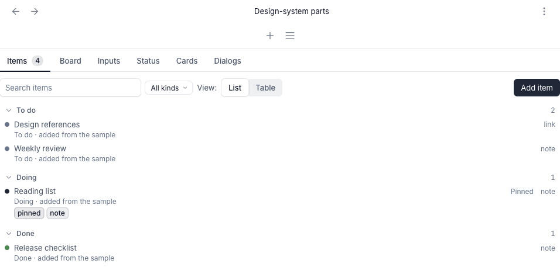 | 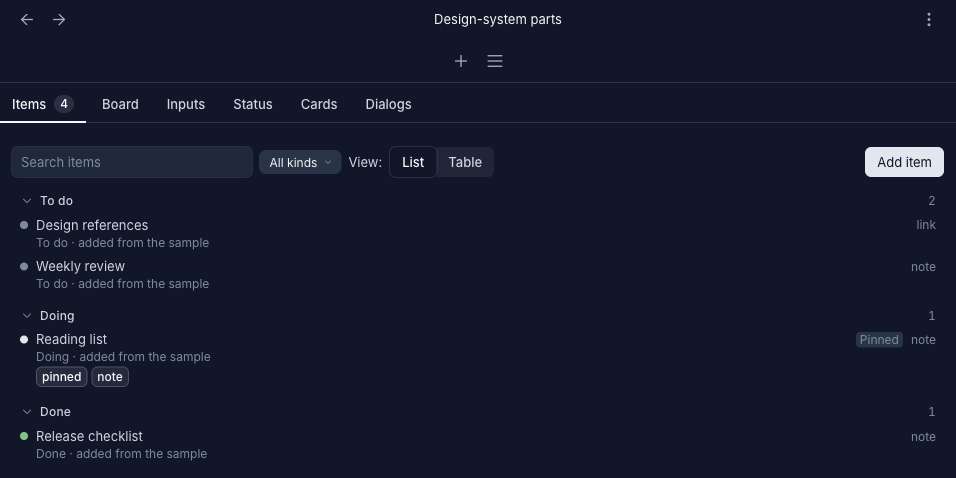 |
| Board | 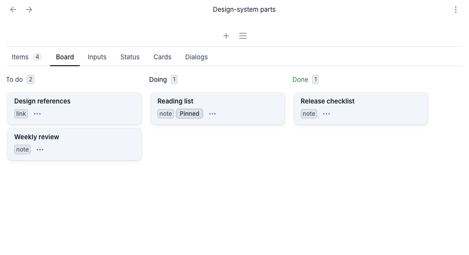 | 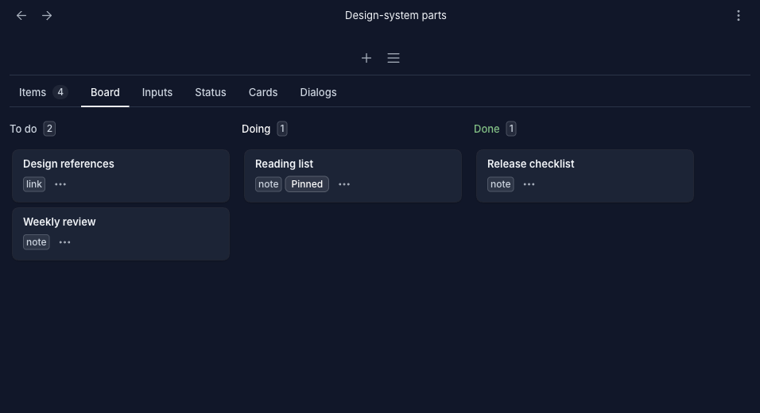 |
| Inputs | 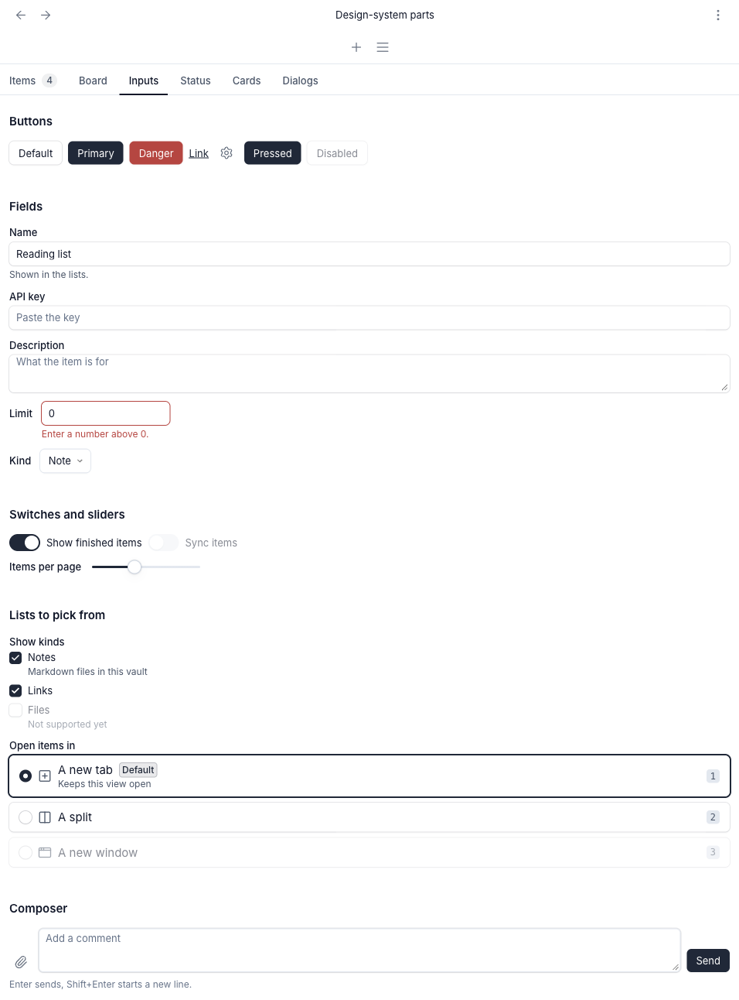 | 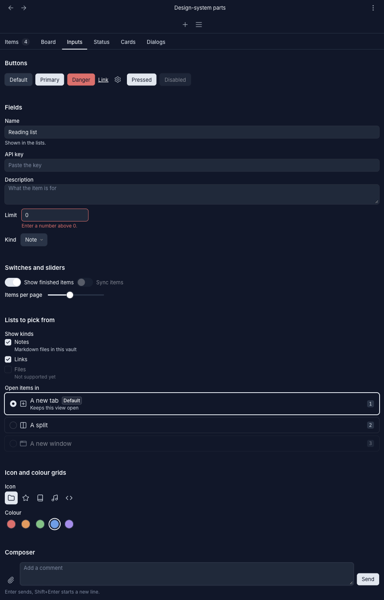 |
| Status | 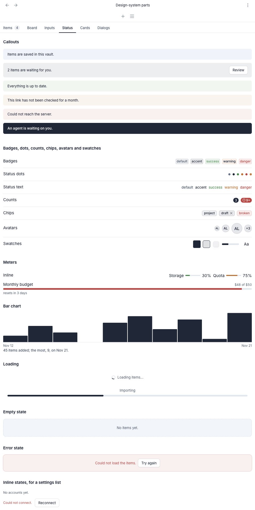 | 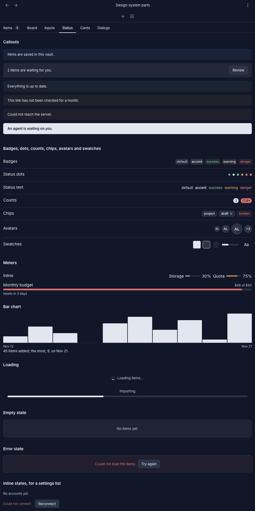 |
| Cards | 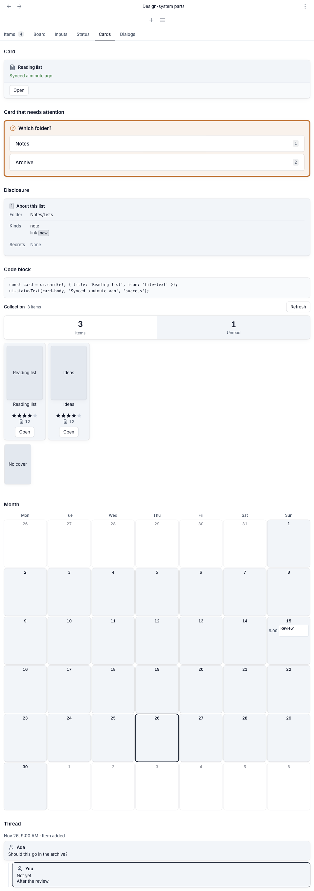 | 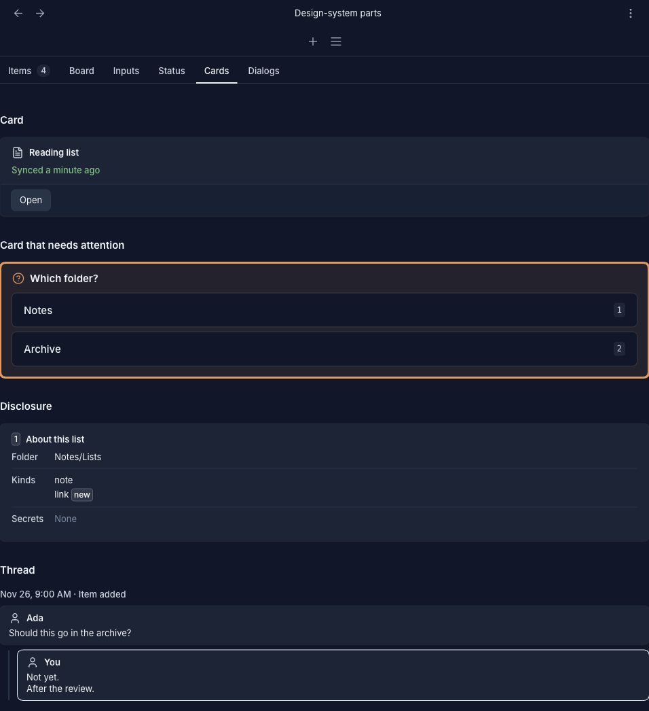 |
| Dialogs | 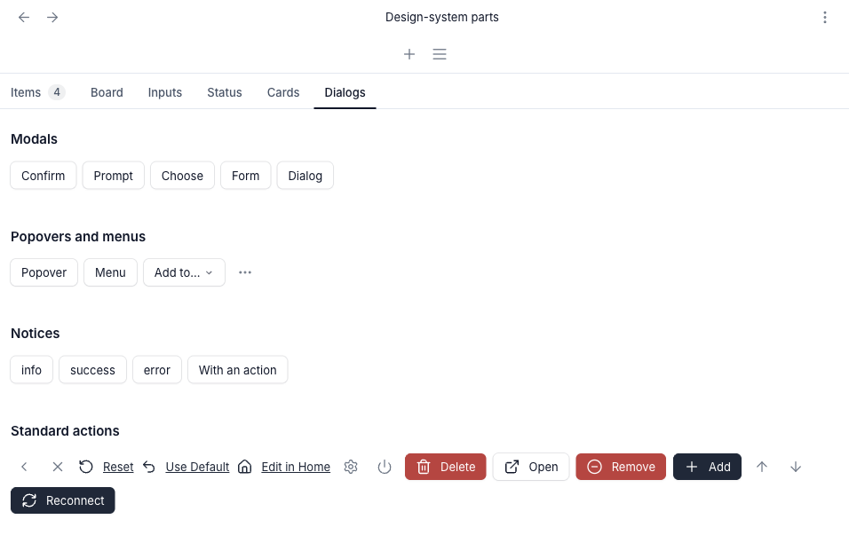 | 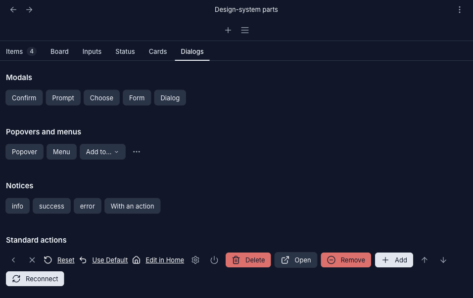 |
| Settings | 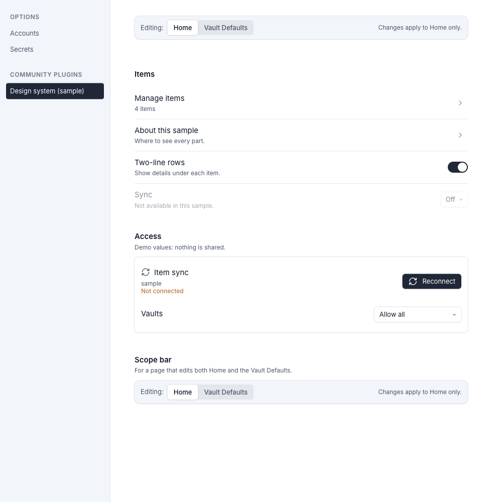 | 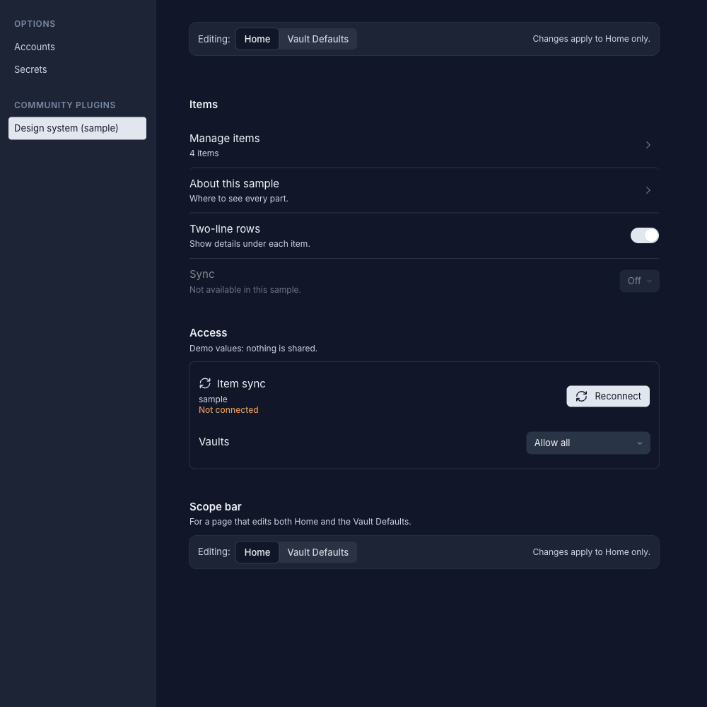 |
| Add item | 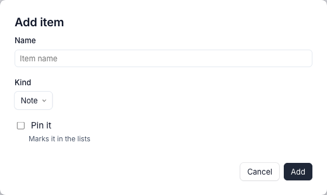 | 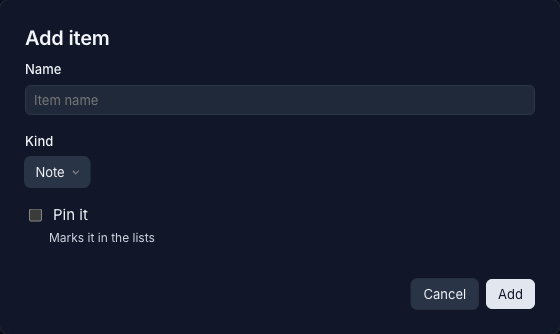 |
