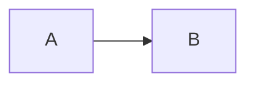

# Content syntax

Smallest example that works for each. Before using a plugin, call `mcp__helenite__vault_capabilities` (`renders`: `yes`, `no`, `unverified`; `blocks`: languages it handles). Prefer plugins that render. After writing, run `note_render_check` on the note and report empty results or errors.

## Core

Callout (types: note, tip, warning, question, success, failure; `-` after the type makes it collapsed):

```
> [!tip] Title
> Body text.
```

Mermaid:

````

````

Embeds and links: `![[Other note]]` embeds a note, `![[Other note#Heading]]` a section, `![[image.png|300]]` an image at 300px, `[[Note|label]]` a link.

Properties (frontmatter at the very top):

```
---
tags: [project]
status: active
due: 2026-12-01
---
```

Canvas: a `.canvas` file containing JSON. Text and file nodes need `id`, `type`, `x`, `y`, `width`, `height`.

```json
{
  "nodes": [
    { "id": "a", "type": "text", "text": "Idea", "x": 0, "y": 0, "width": 200, "height": 80 },
    { "id": "b", "type": "file", "file": "Notes/Plan.md", "x": 300, "y": 0, "width": 300, "height": 200 }
  ],
  "edges": [{ "id": "e1", "fromNode": "a", "toNode": "b" }]
}
```

## Dataview

Query blocks are ` ```dataview `. First word is the type.

````
```dataview
TABLE file.mtime FROM "Projects" SORT file.mtime DESC
```
````

````
```dataview
LIST FROM #project WHERE status = "active"
```
````

````
```dataview
TASK FROM "Projects" WHERE !completed
```
````

DataviewJS, for anything a query cannot express:

````
```dataviewjs
dv.table(["Note", "Modified"], dv.pages('"Projects"').map(p => [p.file.link, p.file.mtime]))
```
````

## Tasks

````
```tasks
not done
due before next week
```
````

Tasks themselves are plain `- [ ] Write report 📅 2026-12-01`.

## Kanban

A markdown file. Frontmatter `kanban-plugin: basic` (newer versions write `board`; either works). Lanes are `## ` headings, cards are `- [ ]` items:

```
---
kanban-plugin: basic
---

## Todo

- [ ] Write spec

## Doing

- [ ] Build prototype

## Done

- [x] Pick a name
```

Warning: Kanban may not render in Helenite. Check `vault_capabilities` first; if `renders` is not `yes`, tell the user and offer a Tasks query or Dataview table instead.

## Meta Bind

Inline input bound to a frontmatter property (here `done`, a boolean):

```
Done: `INPUT[toggle:done]`
```

## Buttons

````
```button
name Open today
type command
action Daily notes: Open today's daily note
```
````

`action` is the exact command name from the command palette.

## Templater

Template notes use `<% %>` expressions, evaluated when the template is inserted:

```
---
created: <% tp.date.now("YYYY-MM-DD") %>
---
# <% tp.file.title %>
```

## Offer layouts

When the user has not picked a layout or plugin, do not describe options in prose. Call `mcp__helenite__ask` with 2-4 options (only plugins whose `renders` is `yes`), each with a small `preview` of the real syntax so they see what they get. Mark your pick `recommended: true`. Example options: "Dataview table" with a `TABLE` preview, "Kanban board" with a lanes preview, "Plain checklist" with `- [ ]` items. Put the reasoning in `context`, which must stand alone because the question opens as its own tab.
